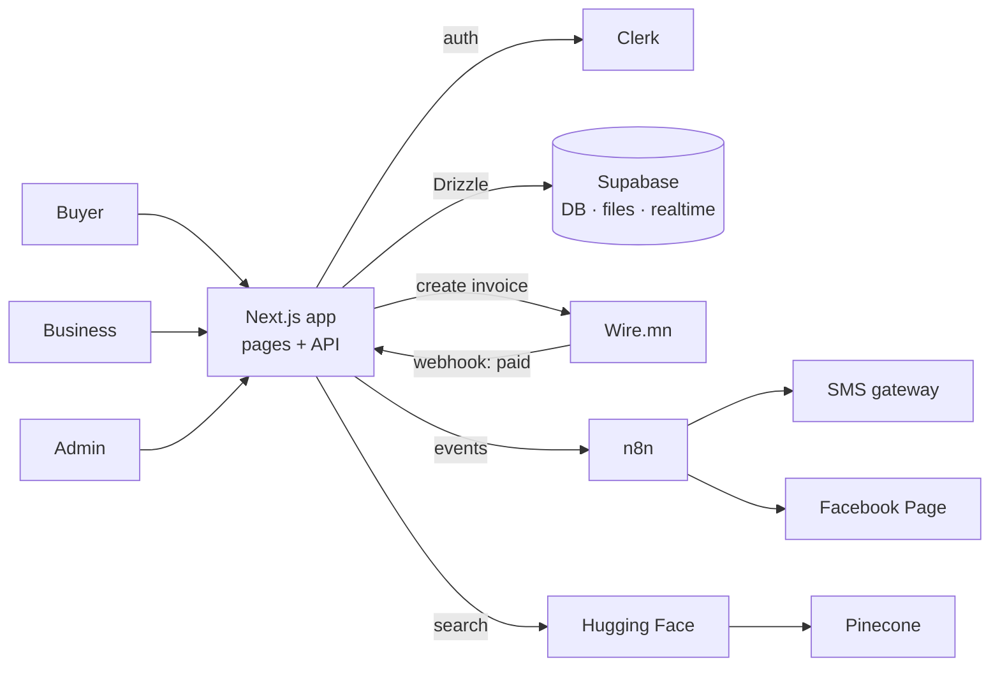
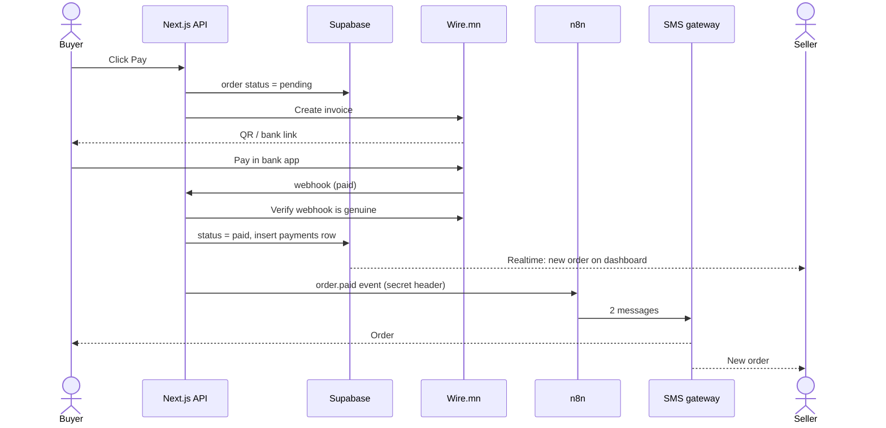
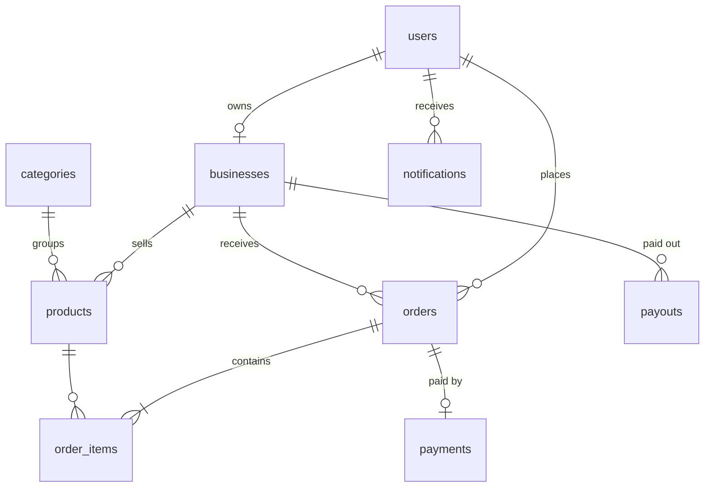

# Wholesale Market Online — 10-Day Build Plan

Food sellers at Ulaanbaatar wholesale markets (Bars, Nariin Nuguu) take orders by phone and keep daily payments and accounts on paper. This web app moves ordering, payment and daily reporting online.

Tech stack follows the Pinebaatars "The Stack" docs: https://pinebaatars-stack.pineconegpt1.workers.dev/#map

---

## Contents

1. [Problem and solution](#1-problem-and-solution)
2. [Roles](#2-roles)
3. [System overview](#3-system-overview)
4. [Workflow 1: Buyer](#4-workflow-1-buyer)
5. [Workflow 2: Business (seller)](#5-workflow-2-business-seller)
6. [Workflow 3: Admin](#6-workflow-3-admin)
7. [Payment to SMS sequence](#7-payment-to-sms-sequence)
8. [What each service does](#8-what-each-service-does)
9. [Database schema](#9-database-schema-drizzle)
10. [Decisions before Day 1](#10-decisions-before-day-1)
11. [10-day plan](#11-10-day-plan)
12. [After day 10 (backlog)](#12-after-day-10-backlog)

---

## 1. Problem and solution

| Today                                                     | With the web app                                               |
| --------------------------------------------------------- | -------------------------------------------------------------- |
| Orders come by phone; they get duplicated or forgotten    | Orders appear instantly on the seller's dashboard, plus an SMS |
| When prices change, the seller tells every customer again | Seller updates the price once; everyone sees it                |
| Payments, debts and accounts live in paper notebooks      | Buyer pays by QR / bank app; payment is recorded automatically |
| Daily sales are added up by hand                          | A daily report is generated every evening                      |

## 2. Roles

| Role                      | Who                                               | What they do                                       |
| ------------------------- | ------------------------------------------------- | -------------------------------------------------- |
| **Buyer** (`buyer`)       | Restaurants, canteens, small shops, individuals   | Browse, order, pay, receive                        |
| **Business** (`business`) | A user who owns a stall or pavilion at the market | Manage products, prices, stock and incoming orders |
| **Admin** (`admin`)       | You, the platform operator                        | Approve shops, monitor payments, refunds, payouts  |

A business is a normal user account that has registered a shop. One user can be both a buyer and a business owner.

## 3. System overview

All pages and API routes live in one Next.js app. Every other service does one job.



---

## 4. Workflow 1: Buyer

```
1. User → 2. Sign in / sign up (Clerk) → 3. Saved to database (Supabase)
→ 4. Choose products → 5. Create order → 6. Pay (Wire.mn)
→ 7. Shows on business + admin pages (Realtime) → 8. SMS to phone (n8n) → 9. Track and receive
```

| #   | Step                                  | What happens                                                                                                                                                                                  | Tech                               |
| --- | ------------------------------------- | --------------------------------------------------------------------------------------------------------------------------------------------------------------------------------------------- | ---------------------------------- |
| 1   | **Open the site**                     | Home page shows categories (meat, flour, oil, vegetables, drinks) and today's wholesale prices. No login needed to browse.                                                                    | Next.js, Supabase                  |
| 2   | **Sign in / sign up**                 | Clerk `<SignIn />` / `<SignUp />`. Phone number + SMS code, or Google. Clerk handles passwords and sessions.                                                                                  | Clerk                              |
| 3   | **Save to database**                  | Clerk sends `user.created` to `/api/webhooks/clerk`. Server inserts a `users` row: clerk_id, phone, name, buyer type, address.                                                                | Clerk webhook, Drizzle, Supabase   |
| 4   | **Choose products**                   | Filter by category, seller or market; search ("uhriin mah", "үхрийн мах" both work). Units: kg / piece / sack / box. Minimum wholesale quantity (e.g. from 10 kg). Choose delivery or pickup. | Next.js, Hugging Face, Pinecone    |
| 5   | **Create order**                      | Server re-reads prices and stock from the DB (never trusts prices from the browser). Saves `orders.status = pending`.                                                                         | API route, Clerk `auth()`, Drizzle |
| 6   | **Pay**                               | Wire.mn invoice → QR / bank app → webhook → verify → `status = paid`.                                                                                                                         | Wire.mn, Supabase                  |
| 7   | **Shows on business and admin pages** | Supabase Realtime listens to `orders`, so the new paid order appears without a page reload.                                                                                                   | Supabase Realtime                  |
| 8   | **SMS to phone**                      | Server calls an n8n webhook with a secret header. Buyer gets "Order #1024 paid, 452,000₮". Seller gets "New order #1024".                                                                     | n8n, SMS gateway                   |
| 9   | **Track and receive**                 | "My orders" page. SMS on every status change. One-tap re-order for regular customers.                                                                                                         | Next.js, n8n                       |

**Order status:**

```
pending → paid → confirmed → preparing → delivering → completed
                     ↘ rejected → refunded
```

---

## 5. Workflow 2: Business (seller)

Only what the business user does. Admin actions (approving shops, refunds, sending payouts) are in [Workflow 3](#6-workflow-3-admin).

| #   | Step                                    | What the seller does                                                                                                                                                                                                | Tech                             |
| --- | --------------------------------------- | ------------------------------------------------------------------------------------------------------------------------------------------------------------------------------------------------------------------- | -------------------------------- |
| 1   | **Sign up and register a shop**         | Signs in with Clerk, clicks "Open a shop" and fills in: shop name, market (Bars / Nariin Nuguu / other), stall or pavilion number, registration number, phone, bank account. Shop is saved with `status = pending`. | Clerk, Drizzle, Supabase         |
| 2   | **Wait for activation, then add staff** | Sees a "Your shop is under review" page. Gets an SMS when the shop is active, and the seller dashboard opens. The owner can invite staff so several sellers at one stall can log in.                                | Clerk Organizations, SMS         |
| 3   | **Add products**                        | Name, category, unit, wholesale price, minimum quantity, stock, photo. Photo goes to Supabase Storage.                                                                                                              | Supabase Storage, Drizzle        |
| 4   | **Update prices daily**                 | Meat prices change every day, so one table lets the seller edit all prices at once. (Later: the price list is auto-posted to the shop's Facebook Page at 9:00.)                                                     | Next.js, n8n, Facebook Graph API |
| 5   | **Receive orders**                      | Paid orders appear live on the dashboard and as an SMS. Clicks "Confirm" or "Reject". If out of stock, picks a reason and rejects; the buyer is told by SMS that the money will be returned.                        | Supabase Realtime, n8n, SMS      |
| 6   | **Prepare, deliver, complete**          | Moves the order through statuses with one button each. Stock decreases automatically on confirm. Gets an alert when stock runs low.                                                                                 | Drizzle, n8n                     |
| 7   | **Daily report (replaces paper)**       | At 21:00 gets an SMS summary; the dashboard shows the full report: total sales, number of orders, top products, paid vs. rejected. Can download CSV.                                                                | n8n, Supabase, SMS               |
| 8   | **See earnings**                        | "Earnings" page shows today's and this week's sales, platform fee, amount already transferred and amount still to come.                                                                                             | Supabase (`payouts`)             |

---

## 6. Workflow 3: Admin

| #   | Step                            | What happens                                                                                                                                                  | Tech                       |
| --- | ------------------------------- | ------------------------------------------------------------------------------------------------------------------------------------------------------------- | -------------------------- |
| 1   | **Sign in to admin**            | Clerk `publicMetadata.role = "admin"`. Middleware protects everything under `/admin`.                                                                         | Clerk middleware           |
| 2   | **Approve shops**               | Reviews pending shops (registration number, stall). "Approve" or "Reject" with a reason. Approving creates the Clerk Organization and sends the owner an SMS. | Clerk API, n8n, SMS        |
| 3   | **Daily dashboard**             | Today's orders, revenue, pending payments, rejected orders. Live via Realtime.                                                                                | Supabase Realtime, Drizzle |
| 4   | **Reconcile payments**          | Matches Wire.mn transactions with `payments`. For orders where the webhook never arrived, asks Wire.mn for the invoice status.                                | Wire.mn                    |
| 5   | **Refunds and disputes**        | Cancels rejected or disputed orders and refunds the buyer. Both sides get an SMS.                                                                             | Wire.mn, n8n               |
| 6   | **Pay out businesses**          | Calculates each shop's sales minus platform fee (e.g. 2%), transfers the money, records it in `payouts`.                                                      | Drizzle, Supabase          |
| 7   | **Manage users and categories** | Adds/edits categories. Blocks fraudulent users or shops (Clerk ban).                                                                                          | Clerk, Next.js             |
| 8   | **Watch for system errors**     | Failed n8n jobs (SMS not sent, FB post failed) notify the admin. n8n retries automatically.                                                                   | n8n                        |

---

## 7. Payment to SMS sequence



> **Rule:** Mark an order `paid` only from the Wire.mn webhook, after verifying it really came from Wire.mn. Never trust the browser saying "payment done". Use Wire.mn test mode while building.

---

## 8. What each service does

| Service                 | Job in this project                                                                                                                 | When                  |
| ----------------------- | ----------------------------------------------------------------------------------------------------------------------------------- | --------------------- |
| **Next.js + shadcn/ui** | All pages (store, cart, seller dashboard, admin), API routes, webhook receivers                                                     | MVP                   |
| **Clerk**               | Sign in / sign up (phone + SMS code, Google). Roles: buyer / business / admin. A shop's team = Organization. `user.created` webhook | MVP                   |
| **Supabase**            | Postgres DB, product photos (Storage), live order updates (Realtime). Do not turn on Supabase Auth                                  | MVP                   |
| **Drizzle**             | Define tables in `schema.ts`, write all queries in TypeScript                                                                       | MVP                   |
| **Wire.mn**             | Invoices, QR, bank app payments, webhook, refunds                                                                                   | MVP                   |
| **n8n**                 | Send SMS, 21:00 daily report, 9:00 Facebook price post, low-stock alerts                                                            | MVP (SMS), rest later |
| **SMS gateway** ⚠️      | Not in the stack; must be added. Call a Mongolian operator's SMS API from an n8n HTTP Request node                                  | MVP                   |
| **Hugging Face**        | Turn product names into vectors (multilingual MiniLM). Later: voice orders with Whisper                                             | Later                 |
| **Pinecone**            | Search by meaning: Latin, Cyrillic, or misspelled names all match. "Similar products"                                               | Later                 |
| **Facebook Graph API**  | Post the daily price list to the shop's Facebook Page                                                                               | Later                 |

> **Check first:** Test whether Clerk SMS-code login works for +976 numbers in the Clerk dashboard. If not, use Google / email code and collect the phone number in a profile form.

---

## 9. Database schema (Drizzle)

| Table           | Key columns                                                                      | Notes                                |
| --------------- | -------------------------------------------------------------------------------- | ------------------------------------ |
| `users`         | id, clerk_id, phone, name, type, address                                         | Created by Clerk webhook             |
| `businesses`    | id, owner_id, clerk_org_id, name, market, stall_no, reg_no, bank_account, status | pending / approved / blocked         |
| `categories`    | id, name, slug                                                                   | Meat, flour, oil, vegetables, drinks |
| `products`      | id, business_id, category_id, name, unit, price, min_qty, stock, image_url       | unit: kg / piece / sack / box        |
| `orders`        | id, buyer_id, business_id, total, status, delivery_type, address, created_at     | One order = one seller               |
| `order_items`   | id, order_id, product_id, qty, unit_price                                        | Price saved at time of order         |
| `payments`      | id, order_id, wire_invoice_id, amount, status, paid_at                           | Written only by the webhook          |
| `payouts`       | id, business_id, period, gross, fee, net, paid_at                                | Money transferred to shops           |
| `notifications` | id, user_id, channel, message, status, sent_at                                   | Tracks whether each SMS was sent     |



---

## 10. Decisions before Day 1

Answer these first; several tasks depend on them.

- [ ] Can one cart contain products from several sellers? (Plan assumes yes, split into one order per seller.)
- [ ] Who delivers: the seller, the platform, or pickup only? (Plan assumes seller delivery + pickup.)
- [ ] Does money go to the platform first, or straight to the seller? (Plan assumes platform first, then payouts.)
- [ ] Platform fee percentage and payout frequency (daily / weekly).
- [ ] Credit for regular customers (pay later): in or out of the first version? (Plan: out.)
- [ ] Which SMS gateway, its price per SMS, and API access.
- [ ] 1–2 real sellers at Bars / Nariin Nuguu willing to test on Day 10.

---

## 11. 10-day plan

Each day ends with a **Done when** check. If a day slips, cut from "nice to have" items, not from payments or SMS.

### Day 1 — Project setup and accounts

- [ ] Create Next.js app (App Router, TypeScript) and add shadcn/ui
- [ ] Create GitHub repo, push first commit
- [ ] Create Clerk app; enable phone (SMS code) and Google sign-in
- [ ] Test Clerk SMS code with a +976 number
- [ ] Create Supabase project (Auth off); create Storage bucket `product-images`
- [ ] Get Wire.mn test-mode keys
- [ ] Set up n8n (cloud or self-hosted)
- [ ] Sign up for the SMS gateway; send one test SMS by hand
- [ ] Write `.env.local` with all keys; add `.env.example` without values
- [ ] Deploy empty app to Vercel so every later day can be tested online

**Done when:** you can sign in on the deployed site, and a test SMS reached your phone.

### Day 2 — Database and users

- [ ] Write `src/db/schema.ts` with all 9 tables
- [ ] Run `drizzle-kit push`; check tables in the Supabase dashboard
- [ ] Seed `categories` (meat, flour, oil, vegetables, drinks)
- [ ] Build `/api/webhooks/clerk`: verify signature, insert `users` row on `user.created`
- [ ] Add a profile page: name, phone, buyer type, address
- [ ] Store role in Clerk `publicMetadata.role` (default `buyer`)
- [ ] Add middleware: protect `/business/*` and `/admin/*`

**Done when:** a new sign-up creates a `users` row, and a buyer opening `/admin` is redirected.

### Day 3 — Shop registration (business side) and approval (admin side)

- [ ] Business: "Open a shop" form (name, market, stall no., reg. no., phone, bank account)
- [ ] Business: "Your shop is under review" page while `status = pending`
- [ ] Admin: pending shops list with Approve / Reject (+ reason)
- [ ] On approve: create Clerk Organization, set owner as `org:admin`, set `businesses.status = approved`, set role `business`
- [ ] Business: invite staff by phone/email (`org:member`)
- [ ] Make yourself admin (`publicMetadata.role = "admin"` in Clerk dashboard)

**Done when:** a test user registers a shop, you approve it, and the seller dashboard opens for them.

### Day 4 — Products (business side)

- [ ] Product list page on the seller dashboard
- [ ] Add / edit product form: name, category, unit, price, min. quantity, stock
- [ ] Photo upload to Supabase Storage; save URL in `products.image_url`
- [ ] Delete / hide product
- [ ] Bulk price editor: one table, edit all prices, save once
- [ ] Validation: price > 0, min. quantity ≥ 1, stock ≥ 0

**Done when:** a seller can add 10 products with photos and change all prices in under a minute.

### Day 5 — Storefront and cart (buyer side)

- [ ] Home page: categories and today's prices
- [ ] Category page and product list with filters (seller, market)
- [ ] Product detail page: photo, unit, price, min. quantity, seller, stall
- [ ] Simple text search (SQL `ILIKE`; meaning-based search comes later)
- [ ] Cart: add / remove, quantity respects min. quantity and stock
- [ ] Cart grouped by seller with subtotal per seller
- [ ] Mobile layout check (most buyers will use phones)

**Done when:** a buyer can find a product, add it to the cart at the minimum quantity, and see the total.

### Day 6 — Checkout and orders

- [ ] Checkout page: delivery or pickup, address, phone
- [ ] `POST /api/orders`: read prices and stock from DB, never from the browser
- [ ] Split the cart into one order per seller; insert `orders` + `order_items`
- [ ] Save `status = pending`
- [ ] "My orders" page with status for each order
- [ ] Order detail page

**Done when:** a cart with products from 2 sellers creates 2 pending orders with correct totals.

### Day 7 — Payments (Wire.mn)

- [ ] `POST /api/payments/create`: create Wire.mn invoice for an order; save `wire_invoice_id`
- [ ] Payment page: show QR and bank-app link
- [ ] `/api/webhooks/wire`: verify it came from Wire.mn, then insert `payments` row and set `orders.status = paid`
- [ ] Make the webhook safe to receive twice (no double payment)
- [ ] Payment page polls order status and shows "Paid" when the webhook lands
- [ ] Fallback: "Check payment" button asks Wire.mn for the invoice status
- [ ] Full test in Wire.mn test mode

**Done when:** a test payment turns the order to `paid` only through the webhook.

### Day 8 — Live orders and SMS

- [ ] Seller dashboard subscribes to `orders` with Supabase Realtime
- [ ] New paid order appears without reload, with a sound
- [ ] Seller buttons: Confirm / Reject (reason) / Preparing / Delivering / Completed
- [ ] On confirm: decrease stock in a DB transaction
- [ ] n8n webhook `order-event` protected by a secret header
- [ ] App sends `order.paid` and every status change to n8n
- [ ] n8n: build SMS text and call the SMS gateway (buyer + seller)
- [ ] Save each SMS in `notifications` with sent / failed status

**Done when:** paying a test order makes it appear live on the seller's screen and both phones get an SMS.

### Day 9 — Admin tools and daily report

- [ ] Admin dashboard: today's orders, revenue, pending payments, rejected orders
- [ ] Admin orders and payments list with filters
- [ ] Refund flow for rejected / disputed orders (Wire.mn) + SMS to buyer
- [ ] Payouts page: sales minus fee per shop; "Mark as paid" writes `payouts`
- [ ] Block user / shop
- [ ] n8n schedule at 21:00: daily report per shop → SMS summary
- [ ] Seller: daily report page + CSV download
- [ ] Seller: "Earnings" page reading `payouts`

**Done when:** at 21:00 a test seller gets a correct SMS summary, and you can mark a payout as paid.

### Day 10 — Test, fix, pilot

- [ ] Run the whole flow on a phone: sign up → open shop → approve → add products → order → pay → SMS → complete → report
- [ ] Test with two users at once (buyer and seller on different phones)
- [ ] Error states: payment failed, out of stock, SMS failed, empty pages
- [ ] Check every API route uses `auth()` on the server and checks role
- [ ] Remove test data; add real categories
- [ ] Onboard 1–2 real sellers and enter their products with them
- [ ] Watch real orders for the day; write down every problem
- [ ] Decide when to switch Wire.mn from test mode to live

**Done when:** a real seller receives and completes a real order through the app.

---

## 12. After day 10 (backlog)

| Feature                                         | Uses                    | Why                                         |
| ----------------------------------------------- | ----------------------- | ------------------------------------------- |
| Meaning-based search (Latin / Cyrillic / typos) | Hugging Face, Pinecone  | Buyers type "uhriin mah" or "үхрийн мах"    |
| Auto-post daily prices to Facebook at 9:00      | n8n, Facebook Graph API | Sellers already sell on Facebook            |
| One-tap re-order                                | Next.js                 | Restaurants order the same things every day |
| Low-stock alerts                                | n8n                     | Seller restocks before running out          |
| Credit ledger for regular customers             | Supabase                | Replaces the paper debt notebook            |
| Voice orders                                    | Hugging Face Whisper    | Many buyers prefer to talk instead of type  |
| Stock forecast                                  | Supabase data           | Order the right amount from suppliers       |
